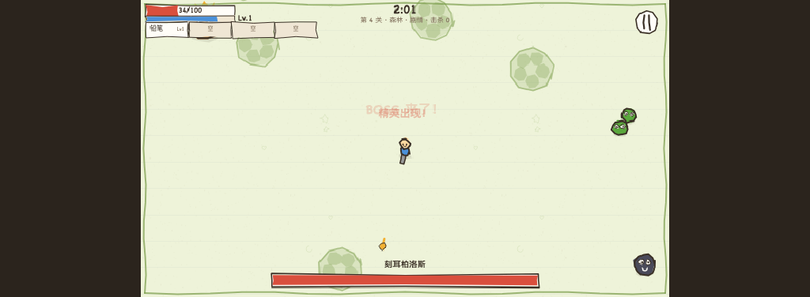
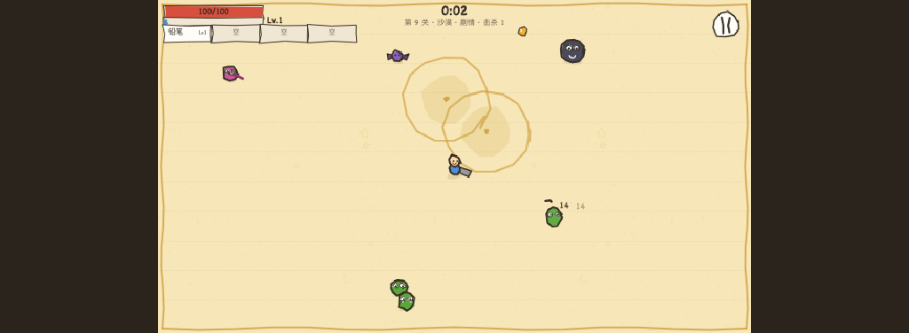
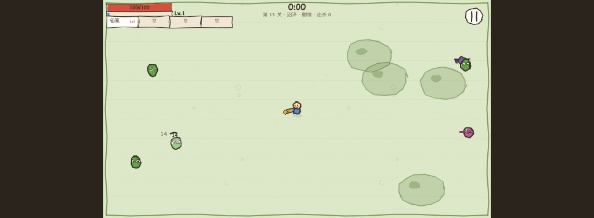

# 纸片幸存者 · Paper Survivors（P1 垂直切片）

参考 [doodle-survivors](https://github.com/Ninot1Quyi/doodle-survivors) 的机制做的幸存者类原型，手绘蜡笔风，纯 Canvas 2D、无引擎、无素材。

**P1 目标：验证核心循环好不好玩**——自动攻击 → 捡经验 → 升级三选一 → 波次变强 → 精英 → Boss。

在线试玩：**https://paper-survivors.pages.dev**


## 运行

> 交接/开发说明见 [HANDOFF.md](HANDOFF.md)（代码结构、调参位置、待办）。


```bash
cd paper-survivors
python3 -m http.server 8080
# 打开 http://localhost:8080
```

或者直接双击 `index.html`。

开发预览可用 `?map=地图ID` 固定地图，例如 `?map=swamp`、`?map=volcano`、`?map=heaven`；地图 ID 见下表。

九张地图的纯背景总览见 `gallery.html`，页面会隐藏 HUD、人物和怪物，仅展示实际 Canvas 地表、立体地形、场景物件与环境动效。

武器、攻击特效、普通近战/远程怪、精英与 Boss 的集中视觉审阅页见 `combat-gallery.html`；页面使用动画循环同时展示轮廓、预警、命中反馈和层级 UI。

近战「斩」效果专项方案见 `melee-ui.html`，可以切换青刃普通斩、金刃暴击斩与墨裂终结斩，并查看蓄势、切开、命中停顿和纸屑收刀四段节奏。

希腊神话怪物家族方案见 `myth-bestiary.html`：九张地图分别展示对应 Boss、普通近战眷属、远程眷属与精英守卫，并将神话轮廓、地图材质和技能习惯分层设计。

全新的原创 UI 世界观见 `ui-concept-original.html`：「折页猎记」把生命缝成书脊红线、把武器做成页边书签、把 Boss 血量变成横贯书页的封印。页面可直接切换四种武器，并以森林刻耳柏洛斯完整展示“神话原型 → 地图材质 → 技能预警”的映射。

## 操作

| 平台 | 移动 | 攻击 | 暂停 | 音乐 |
|---|---|---|---|---|
| 键鼠 | WASD / 方向键 | 自动索敌 | P / Esc | M 开关 |
| 触屏 | 左半屏摇杆 | 自动索敌 | 右上角按钮 | 主菜单左下角 |

升级时：点卡片，或按 `1` `2` `3`。

主菜单点击昵称可以修改角色名；默认昵称为「艾志恒」，设置保存在本机。昵称会以 Q 版纸条样式显示在角色头顶，并跟随角色移动。

暂停后可选择继续游戏或返回主页面。

## 一局是什么样

- 0 秒开始，敌人从视野外靠近，自动攻击最近的敌人
- 击杀掉经验宝石，靠近自动吸附
- 经验满 → 暂停并弹出 3 张强化卡
- 45 / 90 / 135 秒各刷一只精英（掉更多经验 + 回血）
- 180 秒 Boss「墨迹王」登场：环形弹幕 + 蓄力冲撞 + 召唤小怪
- 击杀 Boss 通关；血量归零则失败

## 已实现（P1.6 + 剧情/无尽框架）

### 纸雕视觉 v1

- 铅笔剑士主角与统一的紫黑墨水敌人家族
- 角色头像、生命/护盾/经验、图标武器槽与关卡进度 HUD
- 图标优先、带稀有度色带的升级卡
- 九张地图的差异化纸雕布景：主题底纸、纸层高地、顶面/侧面、统一投影与氛围动效
- 每张地图拥有专属立体物件：枯树/风滚草、砂岩/龙舌兰、红树林/睡莲、珊瑚/海葵、玄武岩/熔岩口、焦木/黑曜碑、云台/金边天门/神龛与终局腐化物件
- 全部普通怪、精英与 Boss 会继承地图生态外观，并通过叶芽、尘痕、砂刺、苔斑、鱼鳍、熔岩裂纹、焦角、光环或四象纹样保持主题一致
- 地图机制不再共用圆形预警：沙漠是日轮裂纹，海洋是波墙，火山是熔岩裂隙，炼狱是落火轮廓，天宫是折线天雷，终局地图使用四象雷纹
- 低强度环境细节：森林蝴蝶/花瓣、荒漠乌鸦、沙漠风痕、沼泽气泡、海洋鱼影、火山余烬、天宫云海金光与终局暗云雷闪
- 火山与炼狱采用完全不同的地貌语言：火山是自然橙黄熔岩和玄武岩，炼狱是紫红深渊、符文裂隙与邪异晶体；终局雷光会短暂显出远处的巨物头颅和巨爪剪影
- 树木、岩台、石柱等实体障碍会阻挡玩家和怪物；泥潭、水洼等保留机制效果
- 跟随角色移动的 Q 版昵称牌与可返回主页的暂停菜单
- Web Audio 实时合成的轻快背景音乐与战斗反馈音效
- 战斗手感优化：角色移动脚步纸屑、受击闪白，以及仅作用于地图环境层的玩家/精英/Boss 分级轻震屏；人物和界面使用固定手绘种子，不随纸纹抖动
- HUD 增加地图机制状态卡，显示机制名称、下一次触发倒计时或常驻状态；临近触发时低强度闪红提示
- 持续伤害反馈按节奏合并显示，避免每帧重复飘字、粒子和音效
- 暴击属性链：基础暴击率 8%、暴击伤害 1.75 倍；「幸运星」每级增加 7% 暴击率，最多 5 级
- 武器槽显示主题色带、武器名称、等级、实时冷却环和就绪状态；铅笔、弹弓与美工刀拥有独立弹道/刀光，暴击使用金色星芒、专属飘字和音效
- 武器库扩展为 9 把：铅笔、弹弓、美工刀、泡泡纸、长尺、蜡笔、折纸回旋镖、橡皮炸弹和圆规；回旋镖会回返，橡皮命中爆炸，圆规与泡泡拥有环形脉冲
- 每把武器可升到 6 级，每级拥有命名形态和行为特征；3 级为形态觉醒，6 级为最终形态。升级会改变弹数、穿透、范围、回返速度、爆炸半径、环刃数量或护盾脉冲
- 被动道具：回形针磁环、透明胶带、量角器、纸风车、墨水瓶；通过升级卡获得并显示在 HUD 道具栏
- 五类主附魔拥有独立反馈：守御结界是青色再生挡弹层，蛇毒墨迹产生绿色毒泡，寒霜刻印生成冰壳与冰晶，爆裂火种显示纸片炸弹和橙红冲击波，雷罚封印从上方劈下并禁锢命中区域
- 守御、毒、冰、爆炸、雷电共用一个主附魔槽并严格互斥：选中后其他主附魔立即从升级池移除，只保留当前主附魔的后续等级；一次性被动道具获得后不会再次推荐
- 辅助附魔扩充为七类：弹反、穿透、折射、分叉、吸墨、推页、寻迹。它们可以同时搭配主附魔与彼此组合，分别提供弹射、分裂子弹、吸血、击退和轻度追踪；各自最多 2—3 级
- 战斗视觉 v1.2：美工刀升级为外层风压、主刀光、内沿高光与命中纸屑组成的多层月牙斩；远程怪增加锁定虚线、枪口星芒和墨弹；精英增加徽章、金色血条及重击冲击环；Boss 增加蓄力光环、方向线、招式名和专属弹幕
- 希腊神话怪物家族已接入实机：九张地图的普通近战、远程、精英与 Boss 使用不同神话轮廓；森林是守门犬系、荒漠是迷宫牛首系、沙漠是谜狮系、沼泽是海德拉蛇系、海洋是斯库拉触腕犬首系、火山是提丰火蛇系、炼狱是蛇母眷属、天宫是独眼锻匠系、终局是四象原初影

### 地图机制（9 张图各不相同）

每张地图有自己的**环境机制**，可以针对怪物、也可以针对玩家——核心玩法是**溜怪**：把怪引到机制里杀掉。

| 地图 | 机制 | Boss（希腊神话） |
|---|---|---|
| 森林 | 灌木丛：怪物经过减速 60%，玩家不受影响 | 刻耳柏洛斯 |
| 荒漠 | 风滚草：定期滚过战场，撞到双方都掉血 | 弥诺陶洛斯 |
| 沙漠 | 烈日灼烧圈：预警 1.2 秒后爆炸，范围伤害 | 斯芬克斯 |
| 沼泽 | 泥潭：怪物减速 55%，玩家可借地形风筝 | 海德拉 |
| 海洋 | 浪潮：横扫战场，推挤并造成伤害 | 斯库拉 |
| 火山 | 熔岩喷发：连续预警圈 | 提丰 |
| 炼狱 | 火雨：多段落火 | 厄喀德那 |
| 天宫 | 天雷：自动劈最近的 3 只怪 | 库克罗普斯 |
| 风林火山 | 四象轮转：风（加速）/林（回血）/火（灼烧）/山（怪物迟缓） | 卡俄斯 |







### 剧情模式

- **9 张地图 × 4 关 = 36 关**，顺序：森林→荒漠→沙漠→沼泽→海洋→火山→炼狱→天宫→风林火山
- 每关 2:00 或 90 击杀（至少 60 秒）→ 普通关直接过关，**每 4 关一个 Boss**
- Boss 击杀过关；build（武器/附魔/属性/血量）跨关保留
- 每关敌人血量 ×1.10 递增，Boss 血量每张地图 ×1.30

### 无尽模式

- 菜单可选「无尽模式」，每关随机一张地图
- 每 4 关一个随机 Boss，数值沿同一曲线继续涨

### 怪物（8 种，各有行为）

| 怪物 | 行为 |
|---|---|
| 墨滴（史莱姆） | 直线追击 |
| 纸蝠 | 蛇形突进 |
| 墨团 | 慢速高血 |
| 喷墨者 | 保持距离 + 远程射击 |
| 分裂墨 | 死亡分裂成两只小墨滴 |
| 跳跳纸 | 周期性跳跃突进 |
| 近战精英 | 高血、高接触伤害 + 王冠 |
| 远程精英 | 保持中远距离、明显瞄准前摇、三向地图主题弹幕 |

### 武器（4 个槽位，Lv3/6/9 各解锁一个）

| 武器 | 类型 | 特点 |
|---|---|---|
| 铅笔飞镖 | 远程 | 单发直线，自动索敌 |
| 弹弓 | 远程 | 三连散射，射程短 |
| 美工刀 | 近战 | 扇形挥砍，伤害高但要贴身 |
| 护盾泡泡 | 增益 | 30 点护盾 + 护盾期间概率弹反 |

武器 Lv1–5，每级 +35% 伤害、−6% 间隔。

### 附魔（每种可升 3 级）

主附魔严格互斥：选中一种后，升级池只会继续提供它的后续等级，不再推荐其他主附魔。

| 附魔 | 效果 |
|---|---|
| 守御结界（主） | 生成独立再生结界，优先抵挡远程攻击 |
| 蛇毒墨迹（主） | 命中施加持续毒伤，怪物出现绿色毒泡反馈 |
| 寒霜刻印（主） | 命中减速并在怪物身上生成冰壳 |
| 爆裂火种（主） | 命中产生范围爆炸（半径和伤害随等级涨） |
| 雷罚封印（主） | 命中后落下一道雷，范围伤害并短暂禁锢敌人 |
| 辅助附魔 | 弹反、穿透、折射、分叉、吸墨、推页、寻迹，可与主附魔共存 |

### 属性卡

伤害 +30%、攻速 +20%、暴击率 +7%、移速 +10%、生命 +25、拾取 +35、回血 40。

### 难度

| | 简单 | 精英（默认） | 冒险家 |
|---|---|---|---|
| 敌人血量 | ×0.75 | ×1.0 | ×1.35 |
| 敌人伤害 | ×0.70 | ×1.0 | ×1.30 |
| 刷怪频率 | ×0.85 | ×1.0 | ×1.20 |
| 经验获取 | ×1.15 | ×1.0 | ×0.90 |

### 关卡节奏

- 2:00 或 90 击杀（且至少 60 秒）→ **墨迹王登场**
- 击杀 Boss 通关，血量归零失败

> 完整 36 关剧情与 9 张地图已经进入初版；融合进化等后续规划见 [DESIGN.md](DESIGN.md)。

## 数值在哪调

全在 `game.js` 顶部附近，改完刷新即可：

- 玩家：`player`（速度 122 / 生命 100 / 拾取 140）
- 武器：`weapon`（伤害 14 / 间隔 0.4s / 射程 300）
- 敌人：`enemyDef()`（血量、速度、伤害、经验）
- 难度：`hpScale()`（每 90 秒血量 +1 倍）、`spawnTimer` 公式
- Boss：`spawnBoss()`（1500 血）与 `updateBoss()`（弹幕 2.6s、冲撞 7s、召唤 11s）
- 精英时间点：`eliteTimes = [40, 80]`（远程、近战交替）
- 升级曲线：`player.xpNeed`

## 调试

控制台里有 `__ps`：

```js
__ps.state              // menu | play | levelup | paused | dead | win
__ps.player             // 位置 / 血量 / 等级 / 经验
__ps.enemies            // 当前敌人
__ps.time
__ps.setTime(180)       // 快进到 Boss
__ps.addXp(50)          // 触发升级
__ps.spawnBoss()
__ps.forceWin() / __ps.forceDead()
```

## 初版后续待做

- 武器融合（P2 的核心）
- 商店、图鉴与天气（P3）
- 存档与排行榜

## 已知取舍

- 敌人没有寻路，直线追 + 分离力，被围住会挤成一团
- 远程击杀会让宝石掉在远处，需要主动去捡（这是有意的取舍，不是 bug）
- 手绘渲染每帧重建路径，低端机掉帧时优先调小 `roughCircle` 的分段数
