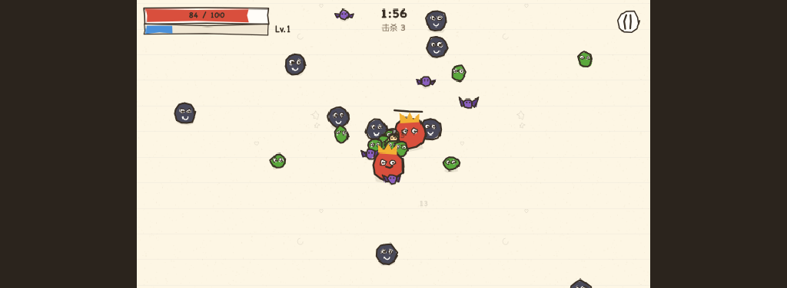
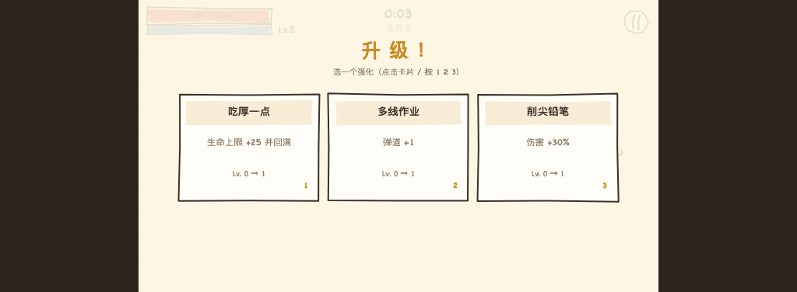

# 纸片幸存者 · Paper Survivors（P1 垂直切片）

参考 [doodle-survivors](https://github.com/Ninot1Quyi/doodle-survivors) 的机制做的幸存者类原型，手绘蜡笔风，纯 Canvas 2D、无引擎、无素材。

**P1 目标：验证核心循环好不好玩**——自动攻击 → 捡经验 → 升级三选一 → 波次变强 → 精英 → Boss。

在线试玩：**https://paper-survivors.pages.dev**





## 运行

```bash
cd paper-survivors
python3 -m http.server 8080
# 打开 http://localhost:8080
```

或者直接双击 `index.html`。

## 操作

| 平台 | 移动 | 攻击 | 暂停 |
|---|---|---|---|
| 键鼠 | WASD / 方向键 | 自动索敌 | P / Esc |
| 触屏 | 左半屏摇杆 | 自动索敌 | 右上角按钮 |

升级时：点卡片，或按 `1` `2` `3`。

## 一局是什么样

- 0 秒开始，敌人从视野外靠近，自动攻击最近的敌人
- 击杀掉经验宝石，靠近自动吸附
- 经验满 → 暂停并弹出 3 张强化卡
- 45 / 90 / 135 秒各刷一只精英（掉更多经验 + 回血）
- 180 秒 Boss「墨迹王」登场：环形弹幕 + 蓄力冲撞 + 召唤小怪
- 击杀 Boss 通关；血量归零则失败

## 已实现的强化

| 卡片 | 效果 | 上限 |
|---|---|---|
| 削尖铅笔 | 伤害 +30% | 8 |
| 手速加快 | 攻速 +20% | 8 |
| 多线作业 | 弹道 +1 | 6 |
| 用力戳穿 | 穿透 +1 | 4 |
| 轻快脚步 | 移速 +10% | 6 |
| 吃厚一点 | 生命上限 +25 并回复 | 6 |
| 大口袋 | 拾取范围 +35 | 4 |
| 创可贴 | 回复 40 生命 | 不限 |

## 数值在哪调

全在 `game.js` 顶部附近，改完刷新即可：

- 玩家：`player`（速度 122 / 生命 100 / 拾取 140）
- 武器：`weapon`（伤害 14 / 间隔 0.4s / 射程 300）
- 敌人：`enemyDef()`（血量、速度、伤害、经验）
- 难度：`hpScale()`（每 90 秒血量 +1 倍）、`spawnTimer` 公式
- Boss：`spawnBoss()`（1500 血）与 `updateBoss()`（弹幕 2.6s、冲撞 7s、召唤 11s）
- 精英时间点：`eliteTimes = [45, 90, 135]`
- 升级曲线：`player.xpNeed`

## 调试

控制台里有 `__ps`：

```js
__ps.state              // menu | play | levelup | paused | dead | win
__ps.player             // 位置 / 血量 / 等级 / 经验
__ps.enemies            // 当前敌人
__ps.time
__ps.setTime(180)       // 快进到 Boss
__ps.addXp(50)          // 触发升级
__ps.spawnBoss()
__ps.forceWin() / __ps.forceDead()
```

## P1 没做的

- 音效和音乐（P2 再说）
- 多武器槽与融合（P2 的核心）
- 商店、图鉴、多地图、天气（P3）
- 存档与排行榜

## 已知取舍

- 敌人没有寻路，直线追 + 分离力，被围住会挤成一团
- 远程击杀会让宝石掉在远处，需要主动去捡（这是有意的取舍，不是 bug）
- 手绘渲染每帧重建路径，低端机掉帧时优先调小 `roughCircle` 的分段数
