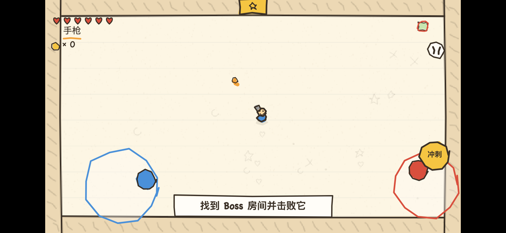

# 元气地牢 · 微信小游戏版（裸写 Canvas）

和 Web 版**共用同一份 `game.js`**（蜡笔手绘风），这里只多了一层 `wx` 适配层。改玩法/改画风只改 Web 版，然后 `./sync.sh` 同步过来，两边不会分叉。



## 目录

```
game.js             入口：装适配层 → 跑游戏
game.json           小游戏配置（横屏、无状态栏）
project.config.json 开发者工具配置（含 touristappid）
src/shim.js         适配层：Canvas / 触摸 / 存储 / 音频 / 定时器
src/game.js         与 Web 版完全一致的 game.js（sync.sh 生成）
sync.sh             从 ../soul-knight-proto/game.js 同步
_dev/               仅开发用：浏览器里模拟 wx 的预览页，打包时已忽略
```

## 在微信开发者工具里跑

1. 打开「微信开发者工具」→ **导入项目**
2. 目录选这个 `soul-knight-minigame` 文件夹（不是里面的 src）
3. AppID：
   - 只是本地看看 → 选 **测试号 / 游客模式**（配置文件里已写 `touristappid`）
   - 要真机预览 / 上传 → 填你自己的小游戏 AppID
4. 编译。第一次会自动生成 `project.private.config.json` 等文件

**真机预览**：工具栏「预览」→ 手机扫码。需要 AppID（游客模式不支持扫码预览）。

**发布**：注册小游戏主体 → 选类目 → 上传代码 → 提交审核。商业化（内购/广告）还涉及版号，建议提前确认。

## 适配层做了什么

Web 版用的是浏览器 API，小游戏里没有 DOM。`src/shim.js` 把它们映射过去：

| Web API | 小游戏实现 |
|---|---|
| `document.getElementById('game')` | `wx.createCanvas()` 包装成主画布 |
| `document.createElement('canvas')` | `wx.createCanvas()` 创建离屏画布（房间预渲染用） |
| `canvas.getBoundingClientRect()` | 按黑边布局算出的游戏区域 |
| `pointerdown/move/up` | `wx.onTouchStart/Move/End` 转成 pointer 事件 |
| `localStorage` | `wx.getStorageSync / setStorageSync` |
| `AudioContext` | `wx.createWebAudioContext`（不支持时静音降级） |
| `requestAnimationFrame` | 原生 rAF（没有则 setTimeout 兜底） |

**画面适配**：主画布固定为屏幕物理像素（`windowWidth × pixelRatio`），游戏按 512×288 等比缩放居中，左右/上下留黑边。适配层拦截了 `ctx.setTransform`，把游戏自己算的缩放替换成「适配层缩放 + 居中偏移」，所以 Web 版一行都不用改。

**触摸夹取**：手指落在黑边上时，坐标会被夹回游戏区域内，避免摇杆画到黑边外面。

## 已知限制

- **iOS 没有 JIT**：小游戏的 JS 跑在 JavaScriptCore 里，CPU 密集逻辑比安卓慢。现在的对象池写法已经是对的方向，真机上如果掉帧，优先降粒子数量和子弹数量。
- **排行榜要走开放数据域**：好友榜必须放在独立 JS 上下文里，需要单独写一个 `open-data-context` 子项目。
- **音频**：`wx.createWebAudioContext` 需要较新的基础库；没有就静音运行，逻辑不受影响。
- **包体**：代码约 70KB，主包 4MB 的限制基本只受美术资源影响。

## 调试

开发者工具 Console 里：

```js
__sk.state          // 'title' | 'play' | 'paused' | 'dead' | 'win'
__sk.player         // 位置 / 血量 / 武器 / 金币
__sk.enemies        // 当前房间敌人
__sk.start(12345)   // 指定种子重开
__sk.jumpTo('boss') // 跳到 Boss 房
```

## 本地预览（不装微信开发者工具）

`_dev/preview.html` 在浏览器里用假的 `wx` 对象跑同一套代码，用来快速验证适配层：

```bash
# 任意静态服务器都行
python3 -m http.server 8080
# 打开 http://localhost:8080/soul-knight-minigame/_dev/preview.html
```

它和真机仍有差异（触摸、音频、GPU），只适合看渲染和输入映射，最终以真机为准。
