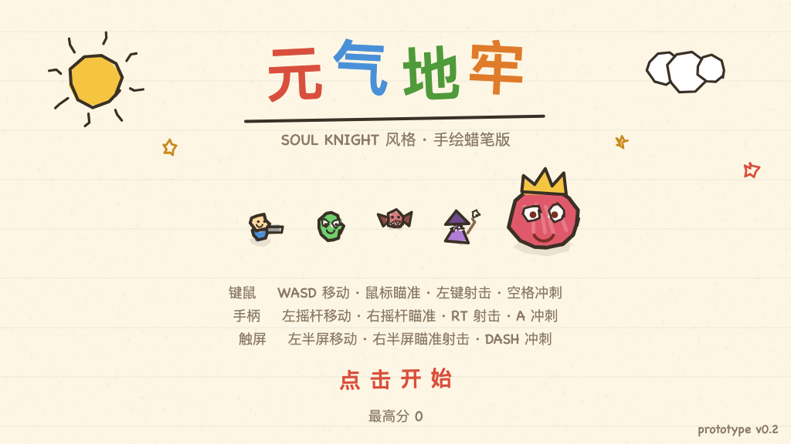
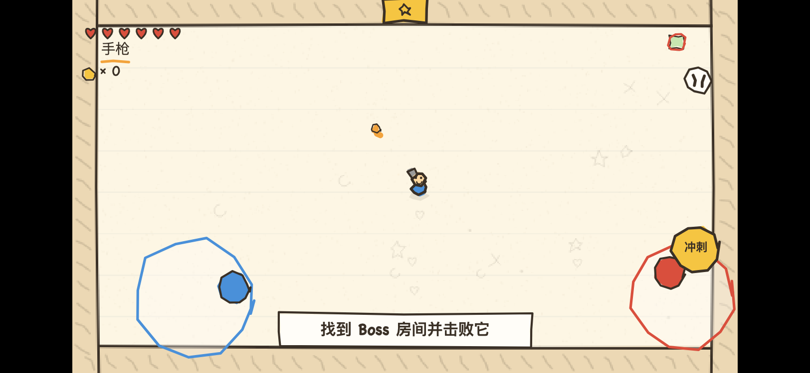
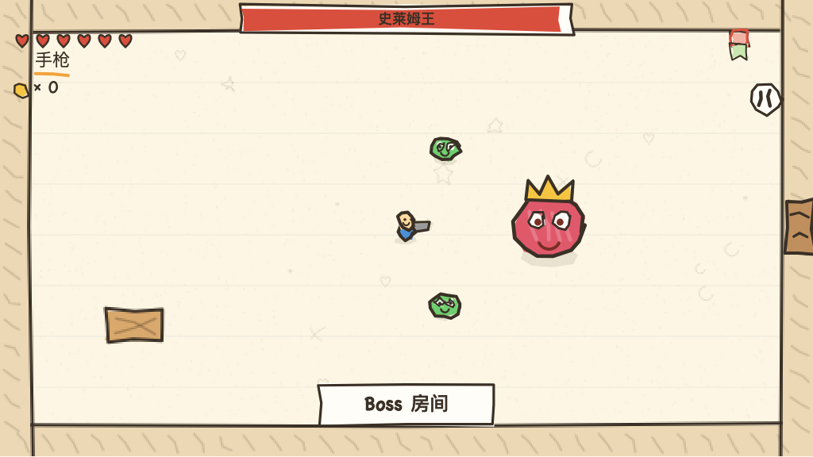
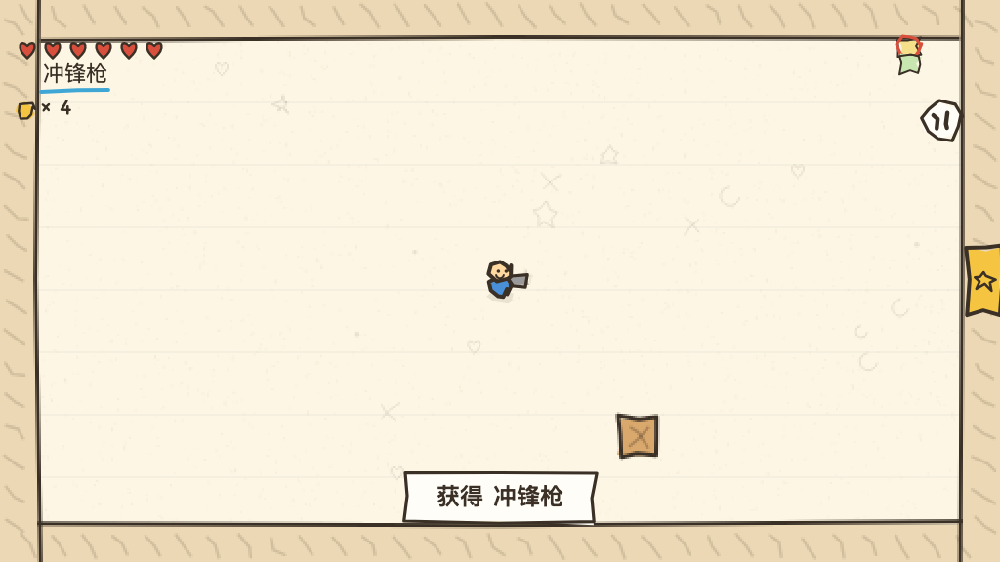

# 元气地牢 · 最小可玩原型

一个不依赖任何游戏引擎、不依赖任何美术素材的 **Canvas 2D** 原型，用来在 PC 和手机浏览器上验证「元气骑士」式玩法的手感与操作方案。

美术是 **蜡笔手绘风**：抖动的手绘线条、故意画出边界的填色、纸张纤维与横格纹理，全部由代码画出来，没有一张图片素材。

目的不是做一个完整游戏，而是回答三个问题：

1. 双摇杆 / 键鼠 / 手柄三套操作能不能共用一套游戏逻辑？
2. 一局「随机房间 → 清怪 → 开门 → Boss」的循环跑起来是什么感觉？
3. 手机上的帧率和操作能不能接受？



## 运行

**桌面**：直接双击 `index.html` 即可（Chrome / Edge / Safari 都行）。

**手机**（推荐横屏）：在电脑上执行

```bash
./serve.sh          # 默认 8080 端口，会打印局域网地址
```

然后手机连同一个 Wi-Fi，浏览器打开脚本打印的 `http://<电脑IP>:8080`。



**调试参数**：

| 参数 | 作用 |
|---|---|
| `?seed=123` | 固定随机种子（复现同一张地图） |
| `?arena=1` | 跳过标题，直接进一个战斗房 |
| `?boss=1` | 跳过标题，直接进 Boss 房 |

## 操作

| 平台 | 移动 | 瞄准 | 射击 | 冲刺 | 其他 |
|---|---|---|---|---|---|
| 键鼠 | WASD / 方向键 | 鼠标 | 左键 或 J | 空格 | P / Esc 暂停，M 静音 |
| 手柄 | 左摇杆 | 右摇杆 | RT / RB | A | — |
| 触屏 | 左半屏浮动摇杆 | 右半屏摇杆 | 右摇杆自动开火 | 右下角 DASH | 右上角暂停 |

触屏模式下，如果右摇杆没有操作，会自动索敌并开火（和元气骑士的移动端一致）。

## 已经实现

- **完整一局循环**：随机迷宫房间图 → 清空房间解锁门 → 宝藏房 → Boss 房 → 通关结算
- **4 把武器**：手枪 / 冲锋枪 / 霰弹枪 / 激光枪（穿透），武器箱替换
- **4 种敌人**：史莱姆（跳劈追击）、蝙蝠（蛇形突进）、法师（保持距离 + 弹幕）、史莱姆王（环形弹幕 + 召唤小怪 + 残血加速）
- **手感细节**：冲刺无敌帧、受击无敌 + 闪烁、击退、屏幕震动、枪口火花、粒子、金币吸附
- **程序化房间**：随机 DFS 生成连通迷宫、BFS 找最远房间做 Boss、死胡同做宝藏房
- **HUD**：血量、武器、金币、小地图（已探索房间 / Boss 位置）、Boss 血条
- **程序化音效**：WebAudio 合成，零素材
- **手绘渲染**：所有形状用带抖动的折线重画，填色与描边各画一遍（所以会“涂出线外”），每 1/8 秒换一次随机种子制造轻微的手绘抖动
- **工程结构**：固定步长逻辑（1/60）、子弹与粒子对象池、房间纸张/墙体离屏预渲染





## 代码结构

`game.js` 约 1900 行，单文件但按模块分段：

| 分段 | 内容 | 迁移到 Unity 对应 | 迁移到 Godot 对应 |
|---|---|---|---|
| 1 | 常量、武器/敌人配置表 | ScriptableObject | `Resource` |
| 2 | 画布与 DPR 适配 | Canvas Scaler | 项目设置 → 显示 |
| 3 | 程序化音效 | AudioSource + 生成 AudioClip | `AudioStreamGenerator` |
| 4 | 输入抽象（三端 → 统一向量） | Input System（PlayerInput） | InputMap |
| 5 | 关卡生成 | 自定义 Generator + Tilemap | `TileMapLayer` + 脚本 |
| 6 | 实体与碰撞 | MonoBehaviour + Rigidbody2D | `CharacterBody2D` |
| 7 | 渲染与 HUD | SpriteRenderer + Canvas | `Sprite2D` + `CanvasLayer` |
| 8 | 主循环 | `Update` / `FixedUpdate` | `_physics_process` |

几个刻意做对的点：

- **输入抽象**：键鼠、触屏、手柄只负责填充 `moveVec()` / `aimVec()` / `firing`，玩法代码完全不区分平台。
- **数据驱动**：`WEAPONS` 和 `ENEMY_DEF` 是纯配置，加武器/敌人只需要加一条数据。
- **固定步长**：逻辑固定 1/60，渲染跟 rAF，手机掉帧不会改变游戏速度。
- **对象池**：子弹和粒子高频生灭，避免 GC 卡顿。
- **房间缓存**：地面/墙体/障碍渲染到离屏 canvas，每帧一次 `drawImage`。

## 调试接口

打开控制台可以直接读游戏状态、调参数：

```js
__sk.state              // 'title' | 'play' | 'paused' | 'dead' | 'win'
__sk.player             // 位置、血量、武器、金币
__sk.enemies            // 当前房间敌人
__sk.room               // 当前房间（links / type / cleared）
__sk.cells              // 整张房间图
__sk.start(12345)       // 用指定种子重开
__sk.jump('boss')       // 跳到 Boss 房（'combat' / 'treasure' / 'boss'）
```

想调手感，最直接的地方：

```js
__sk.player.speed = 130;         // 移速
__sk.player.weapon = 3;          // 换武器（0-3）
__sk.enemies[0].speed = 10;      // 让敌人变慢
```

## 刻意没做的

| 项目 | 原因 |
|---|---|
| 在线联机 | 工作量 ≈ 再做半个游戏，建议单独立项 |
| 存档与元进程（宝石、角色解锁、花园） | 留存核心，但不是"验证手感"阶段该做的事 |
| 大量内容（几百把武器、房间模板） | 需要内容管线，先验证循环再堆量 |
| 美术资源 | 现在全是程序化绘制，接图集是下一步 |
| 寻路（A* / NavMesh） | 现在是直线追击 + 分离力，障碍多时会绕不开 |

## 建议的下一步

1. **先玩 5 分钟**，记录哪里别扭：移速、射击间隔、敌人数量、冲刺距离。手感是改出来的，不是想出来的。
2. **参数集中化**：把散落的数值收进一个 `CONFIG`，方便调。
3. **接美术**：图集 + 简单的帧动画（跑步 / 受击 / 死亡），这一步会明显提升"完成度"。
4. **决定引擎**：
   - 要商业化上架、接 SDK、长期运营 → **Unity + C#**
   - 追求零授权成本、快速迭代、自己完全掌控 → **Godot 4 + GDScript**
   - 主攻国内小游戏/手游渠道 → **Cocos Creator + TypeScript**
5. **合规提前确认**：国内商业发行需要版号，周期长，别等到做完才发现。
6. **联机放到第二阶段**，先用同屏合作验证"多人一起玩是否真的更好玩"。

## 已知限制

- 触屏是"右摇杆即开火"，没有独立射击按钮（可以加，但会占屏幕）。
- 敌人没有寻路，房间障碍多时可能卡住。
- 没有视线遮挡（LOS），法师可以隔墙预判你。
- 音效是合成的，比较简陋。
- 手绘渲染比纯色块更吃 CPU：每帧要拼不少路径，低端机上如果掉帧，优先调小 `roughCircle` 的分段数。
- 手机浏览器地址栏会占高度，建议"添加到主屏幕"后全屏玩。

## 微信小游戏版

想跑在微信小游戏里，见 [`../soul-knight-minigame`](../soul-knight-minigame)：那边复用同一份 `game.js`，只加了一层 `wx` 适配层，`./sync.sh` 保持同步。

## 重新部署

改完代码后，两种方式都行，**链接永远不变**：

**A. 网页上传（无需 Token）**
Cloudflare → Workers & Pages → `soul-knight` → **Create deployment** → 把 `dist` 文件夹拖进去 → Deploy

**B. 命令行**
```bash
./pack.sh
CLOUDFLARE_API_TOKEN=xxx CLOUDFLARE_ACCOUNT_ID=yyy ./deploy.sh
```
Token 权限只要一条：`Account → Cloudflare Pages → Edit`，建议 7 天有效期，用完删掉。

## 文件

```
index.html      页面外壳 + 竖屏提示
game.js         全部游戏逻辑（约 1900 行）
serve.sh        局域网启动脚本（手机联调用）
pack.sh         打包出 dist/（只有 index.html + game.js）
deploy.sh       一键打包 + 部署到 Cloudflare Pages
shots/          截图
```
